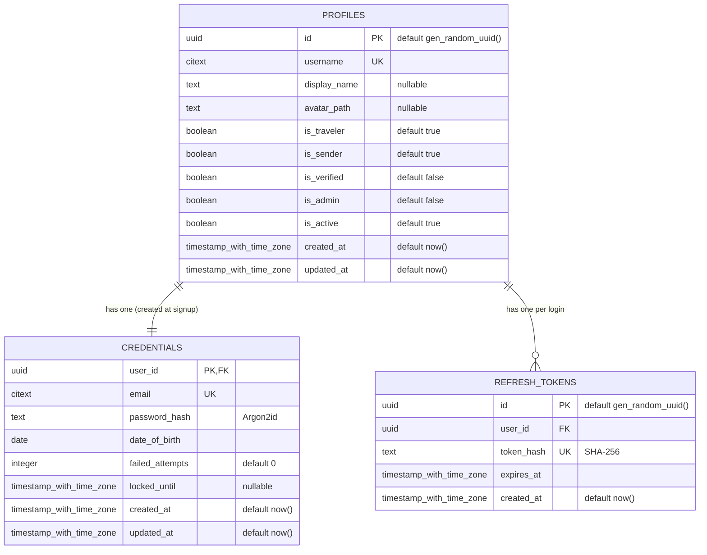

# Database diagram (ERD)

Checked against the real schema on `cargoshare-dev` on 2026-11-05, after the migrations in `supabase/migrations/` were applied. Update it whenever a migration changes a table.

Every table is ours. Sign-in does not use Supabase Auth.

## `public.profiles` constraints
| Name | Rule |
|---|---|
| `profiles_username_key` | `UNIQUE (username)` |
| `profiles_pkey` | `PRIMARY KEY (id)` |
| `profiles_display_name_format` | `CHECK (((display_name IS NULL) OR is_valid_display_name(display_name)))` |
| `profiles_has_a_role` | `CHECK ((is_traveler OR is_sender))` |
| `profiles_username_format` | `CHECK (is_valid_username((username)::text))` |

Rule helpers (each rule is written once): `public.is_valid_username(text)` = `^[a-z0-9_]{3,30}$`; `public.is_valid_display_name(text)` = 1 to 60 characters with no surrounding spaces.

## Triggers
| Trigger | Table | Does |
|---|---|---|
| `profiles_set_updated_at` | `profiles` | Sets `updated_at` to now on every update |
| `credentials_set_updated_at` | `credentials` | Sets `updated_at` to now on every update |

## Access
| Role | `profiles`, `credentials`, `refresh_tokens` |
|---|---|
| `anon`, `authenticated` (browser keys) | No privileges; RLS on with no policies |
| `postgres` (migrations and, for now, the API) | Owner; bypasses RLS. A limited API user is planned for PR29 |
