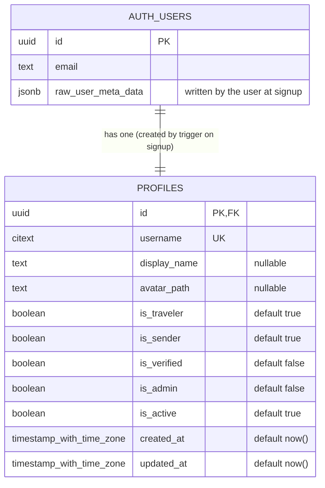

# Database diagram (ERD)

Generated from the real schema on 2026-10-19: the migrations in `supabase/migrations/` were applied inside a transaction on `cargoshare-dev`, read back from the Postgres catalog, and rolled back. Regenerate it whenever a migration changes a table.

`auth.users` belongs to Supabase Auth (only the columns we rely on are shown). Every other table is ours.

## `public.profiles` constraints
| Name | Rule |
|---|---|
| `profiles_username_key` | `UNIQUE (username)` |
| `profiles_pkey` | `PRIMARY KEY (id)` |
| `profiles_id_fkey` | `FOREIGN KEY (id) REFERENCES auth.users(id) ON DELETE CASCADE` |
| `profiles_display_name_format` | `CHECK (((display_name IS NULL) OR is_valid_display_name(display_name)))` |
| `profiles_has_a_role` | `CHECK ((is_traveler OR is_sender))` |
| `profiles_username_format` | `CHECK (is_valid_username((username)::text))` |

Rule helpers (each rule is written once): `public.is_valid_username(text)` = `^[a-z0-9_]{3,30}$`; `public.is_valid_display_name(text)` = 1 to 60 characters with no surrounding spaces.

## Triggers
| Trigger | Table | Does |
|---|---|---|
| `on_auth_user_created` | `auth.users` | Creates the profile row for every new Auth user |
| `profiles_set_updated_at` | `profiles` | Sets `updated_at` to now on every update |

## Access
| Role | `public.profiles` |
|---|---|
| `anon`, `authenticated` (browser keys) | No privileges; RLS on with no policies |
| `postgres` (migrations and, for now, the API) | Owner; bypasses RLS. A limited API user is planned for PR29 |
