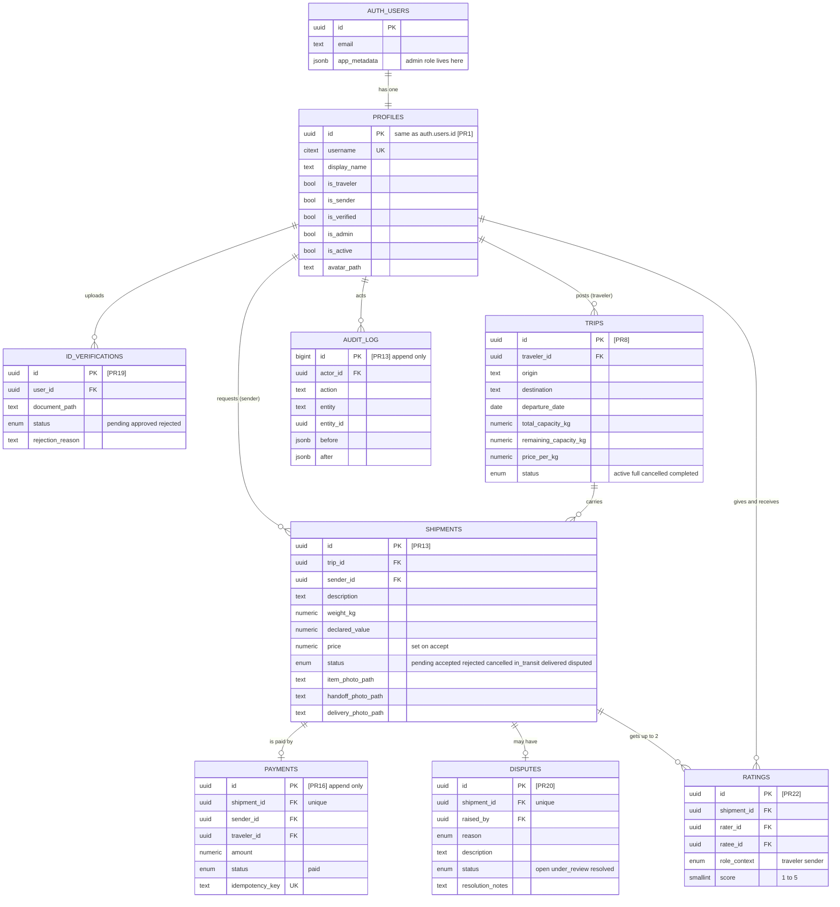
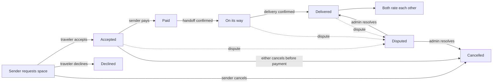
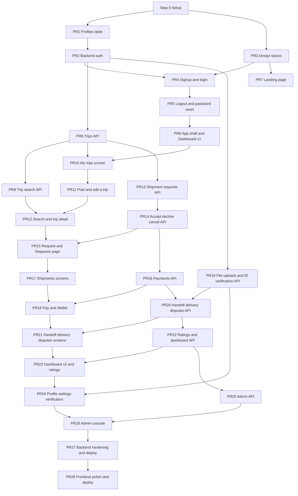
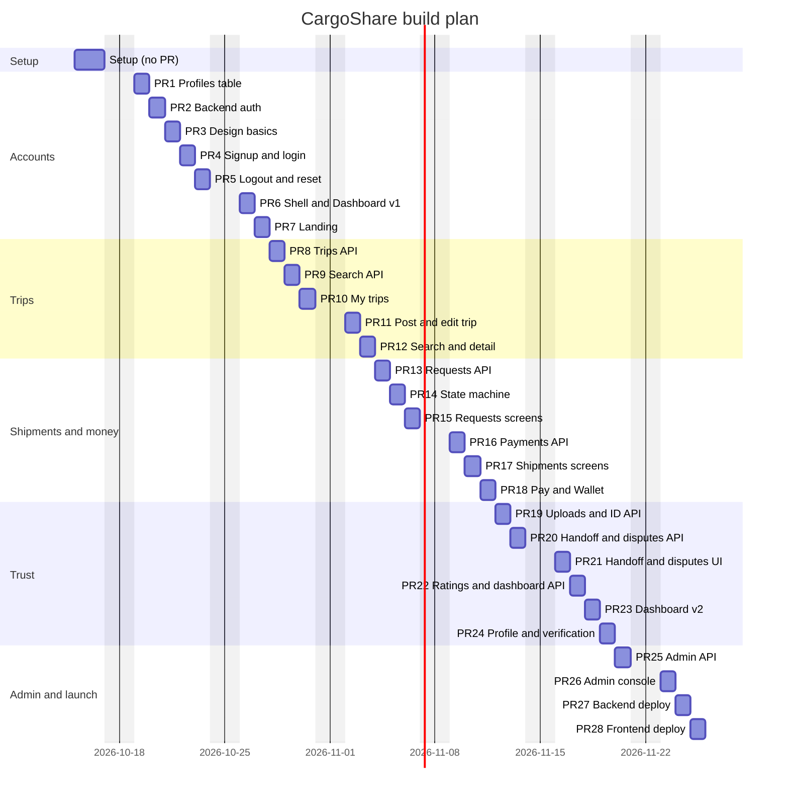

# CargoShare Roadmap

This file is the **order of work**. It says which feature is built in which PR, which files each PR touches, and when the project finishes.

- `backend.md` and `frontend.md` are the **specs**: architecture, data model, business rules, security, design. They say *how* things must be built.
- This file says *what comes next*.

- `docs/PROGRESS.md` records what actually happened.

If this file and a phase list inside `backend.md` or `frontend.md` disagree, **this file wins**. The old phase lists (B0 to B10, F0 to F11) are kept only as reference.

---

## 1. How we build: feature by feature

The first attempt (PR #2) built the whole frontend design system before any feature existed. The Reviewer rejected it. We now build **vertical slices**: each PR delivers one small feature that works end to end (database, API, screen and tests), so every PR can be reviewed and demoed on its own.

Rules for every PR:

| Rule | Detail |
|---|---|
| One feature | One PR does one thing a person can see or test. |
| 10 to 15 files | Count the files changed in the PR. Lockfiles (`pnpm-lock.yaml`, `uv.lock`), generated files (`schema.d.ts`, `docs/openapi.json`) and `docs/PROGRESS.md` / `docs/LEARNING.md` do not count. If a feature needs more than 15, split it into two PRs. |
| Max 3 commits | Squashed before pushing. Each commit builds and passes tests on its own. |
| Tests inside | Every PR ships its own tests. The Reviewer must be able to watch them run (see "Demo" in the PR body). |
| Nothing ahead | No file is added for a later PR. No placeholder pages. |
| Review first | The next PR starts only after the current one is merged. |

The only exception is **Step 0 (Setup)**, which goes straight to `main` without a PR, as agreed with the Reviewer.

---

## 2. Entity diagram (database)

Every table lives in Supabase Postgres. `auth.users` is owned by Supabase Auth; everything else is ours. The PR that creates each table is shown in brackets.

`restricted_keywords` (PR13) is a standalone lookup table with one column, `keyword`.

---

## 3. How a shipment moves (the core flow)

---

## 4. Feature map: which PR builds what

---

## 5. The PR plan

File lists are the **expected** files. Claude Code may adjust names while building, but must stay within 10 to 15 counted files and explain any change in the PR body. Paths: backend files are under `backend/`, frontend files under `frontend/`, migrations under `supabase/migrations/`.

### Step 0: Setup (straight to `main`, no PR, no file limit)
**What:** empty but working projects, tooling and CI for both sides. No features.
- Root: `.gitignore`, `README.md`, `.pre-commit-config.yaml` (gitleaks), `.github/pull_request_template.md`, `.github/workflows/frontend.yml`, `.github/workflows/backend.yml`
- Frontend: Next.js app with strict TypeScript, ESLint, Prettier, Tailwind, Vitest, Playwright (4 devices + axe), `.nvmrc`, `.env.example`, env check that fails the build on a missing variable or a service role key, nonce CSP in `src/proxy.ts`, security headers, one placeholder page, one unit and one e2e smoke test
- Backend: `uv` project, ruff, mypy strict, pytest, `app/main.py`, `app/core/` (config, db session, error envelope, JSON logging, request ID, security headers), `GET /api/v1/health` and `/health/ready`, Dockerfile, `.env.example`, smoke tests
- Supabase: `supabase/config.toml`, both cloud projects linked (dev and test), `docs/SUPABASE_SETUP.md`
- Docs: this roadmap,  `PROGRESS.md`, `VERSIONS.md`, `SECURITY.md`

**Done when:** both CI workflows are green on `main`, `pnpm dev` shows the placeholder page, `uv run fastapi dev` answers `/api/v1/health/ready` with 200 from the dev Supabase database.

### PR1: Profiles table and database lockdown (~10 files)
`migrations/0001_enums_and_helpers.sql`, `migrations/0002_profiles.sql` (table, checks, `updated_at` trigger, profile created on signup, RLS on), `app/models/base.py`, `app/models/profile.py`, `tests/conftest.py`, `tests/db/test_rls_lockdown.py`, `tests/db/test_profile_trigger.py`, `tests/db/test_profile_constraints.py`, `tests/db/test_models_match_db.py`, `docs/ERD.md` (generated from the real schema)
**Demo:** sign up a user in the Supabase dashboard, see the profile row appear; run the lockdown tests.

### PR2: Backend auth and "who am I" (~13 files)
`app/core/security.py` (JWT check via JWKS), `app/api/deps.py` (current user), `app/schemas/profile.py`, `app/repos/profiles.py`, `app/services/profiles.py`, `app/api/v1/me.py` (`GET/PATCH /me`), `app/api/v1/users.py` (`GET /users/{username}`), `app/api/v1/router.py`, `tests/helpers/tokens.py`, `tests/security/test_jwt_failures.py`, `tests/integration/test_me.py`, `tests/integration/test_users.py`, `tests/security/test_mass_assignment.py`
**Demo:** curl `/me` with no token (401), a bad token (401), a real token (200).

### PR3: Design basics (~13 files)
`src/app/globals.css` (paper and ink tokens, bottle green accent), fonts in `src/app/layout.tsx`, `src/lib/theme.ts`, `src/components/theme/theme-toggle.tsx`, `src/components/theme/actions.ts`, `src/components/ui/button.tsx`, `src/components/ui/input.tsx`, `src/components/ui/field.tsx` (label, hint, error), `src/lib/utils.ts`, `components.json`, `tests/unit/tokens.test.ts` (contrast), `tests/unit/theme.test.ts`, `tests/e2e/theme.spec.ts`
**Demo:** placeholder page in light and dark; contrast test output.

### PR4: Signup and login (~13 files)
`src/lib/supabase/server.ts`, `src/lib/supabase/client.ts`, `src/proxy.ts` (refresh session), `src/app/(auth)/layout.tsx`, `src/app/(auth)/signup/page.tsx`, `src/app/(auth)/signup/signup-form.tsx`, `src/app/(auth)/login/page.tsx`, `src/app/(auth)/login/login-form.tsx`, `src/app/auth/callback/route.ts`, `src/lib/validation/auth.ts`, `src/lib/auth/safe-next.ts`, `tests/unit/safe-next.test.ts`, `tests/e2e/auth.spec.ts`
**Demo:** sign up, confirm email, log in, watch the e2e test do it headed.

### PR5: Logout, password reset, protected pages (~11 files)
`src/app/(auth)/forgot-password/page.tsx` + form, `src/app/(auth)/reset-password/page.tsx` + form, `src/lib/auth/actions.ts` (logout), `src/proxy.ts` (redirect logged-out users), `src/lib/api/client.ts` (typed client with token, one refresh and retry on 401), `scripts` entry `gen:api`, `tests/unit/api-client.test.ts`, `tests/e2e/reset-password.spec.ts`, `tests/e2e/protected-routes.spec.ts`
**Demo:** open `/dashboard` logged out, get sent to login; reset password flow.

### PR6: App shell and Dashboard v1 (~14 files)
`src/app/(app)/layout.tsx` (loads `/me`), `src/app/(app)/dashboard/page.tsx` (greeting, Get started checklist, "Nothing needs you right now"), `src/components/shell/app-shell.tsx`, `sidebar.tsx`, `bottom-nav.tsx`, `nav-items.ts`, `nav-link.tsx`, `user-menu.tsx`, `skip-link.tsx`, `src/components/domain/get-started.tsx`, `src/components/feedback/empty-state.tsx`, `tests/unit/nav.test.ts`, `tests/e2e/shell.spec.ts`, `tests/e2e/dashboard.spec.ts`
**Demo:** log in and land on the dashboard on phone and desktop sizes.

### PR7: Landing page and public pages (~13 files)
`src/app/(marketing)/layout.tsx`, `src/app/(marketing)/page.tsx`, `src/components/marketing/site-header.tsx`, `site-footer.tsx`, `src/app/not-found.tsx`, `src/app/error.tsx`, `src/app/robots.ts`, `src/app/sitemap.ts`, `src/app/opengraph-image.tsx`, 3 city photos in `src/assets/photos/`, `docs/CREDITS.md`, `tests/e2e/landing.spec.ts`
**Demo:** landing on a phone width, Lighthouse score.

### PR8: Trips API (~11 files)
`migrations/0003_trips.sql`, `app/models/trip.py`, `app/schemas/trip.py`, `app/repos/trips.py`, `app/services/trips.py` (who can create, edit and cancel), `app/api/v1/trips.py` (create, get, edit, cancel, mine), `app/api/v1/router.py`, `tests/unit/test_trip_rules.py`, `tests/integration/test_trips.py`, `tests/security/test_trips_authz.py`, `tests/db/test_trip_constraints.py`
**Demo:** create and cancel a trip from `/docs` (Swagger) with a real token.

### PR9: Trip search API (~10 files)
`migrations/0004_trip_search.sql` (normalised city columns, trigram index, nightly job that completes old trips), `app/core/pagination.py`, `app/repos/trips.py`, `app/services/trips.py` (full and active auto status), `app/api/v1/trips.py` (search), `app/schemas/trip.py`, `tests/unit/test_pagination.py`, `tests/integration/test_trip_search.py`, `tests/integration/test_trip_auto_status.py`, `scripts/seed_trips.py`
**Demo:** search with 10k seeded trips and show the time.

### PR10: My trips screen (~13 files)
`src/lib/format/money.ts`, `weight.ts`, `date.ts`, `route-code.ts`, `src/lib/status.ts`, `src/components/domain/ticket-pass.tsx`, `status-stamp.tsx`, `route-code.tsx`, `src/app/(app)/trips/page.tsx`, `src/lib/api/trips.ts`, `src/components/providers/query-provider.tsx`, `tests/unit/format.test.ts`, `tests/e2e/my-trips.spec.ts`
**Demo:** trips you created in PR8 show as printed passes.

### PR11: Post and edit a trip (~11 files)
`src/app/(app)/trips/new/page.tsx`, `src/app/(app)/trips/[id]/edit/page.tsx`, `src/components/trips/trip-form.tsx`, `src/lib/validation/trip.ts`, `src/components/ui/dialog.tsx` (cancel confirmation), `src/components/domain/price-breakdown.tsx`, `src/lib/api/trips.ts`, `src/lib/api/errors.ts` (error code to friendly text), `tests/unit/trip-validation.test.ts`, `tests/unit/api-errors.test.ts`, `tests/e2e/trip-lifecycle.spec.ts`
**Demo:** post, edit, cancel a trip in the browser.

### PR12: Search and trip detail (~12 files)
`src/app/(app)/search/page.tsx`, `src/components/search/search-filters.tsx`, `search-results.tsx`, `src/app/(app)/trips/[id]/page.tsx`, `src/components/domain/capacity-bar.tsx`, `src/components/ui/ledger.tsx`, `src/components/ui/sheet.tsx` (filters on phones), `src/lib/api/trips.ts`, `src/lib/search-params.ts`, `tests/unit/search-params.test.ts`, `tests/e2e/search.spec.ts`, `tests/e2e/trip-detail.spec.ts`
**Demo:** filters survive refresh and can be shared as a link.

### PR13: Shipment requests API (~13 files)
`migrations/0005_shipments.sql` (shipments, restricted_keywords, audit_log), `app/models/shipment.py`, `app/models/audit.py`, `app/schemas/shipment.py`, `app/repos/shipments.py`, `app/services/restricted_items.py`, `app/services/audit.py`, `app/services/shipments.py` (create), `app/api/v1/shipments.py` (create, get one, list mine), `tests/unit/test_restricted_items.py`, `tests/integration/test_shipment_create.py`, `tests/security/test_shipments_authz.py`, `tests/db/test_audit_append_only.py`
**Demo:** a request with "guns" in it is blocked; "gunny sack" is allowed.

### PR14: Accept, decline, cancel (state machine) (~10 files)
`app/services/shipment_state.py` (the one function that decides every move), `app/services/shipments.py` (accept with row lock, decline, cancel), `app/api/v1/shipments.py`, `app/schemas/shipment.py`, `tests/unit/test_state_machine.py` (every allowed and forbidden move), `tests/concurrency/test_last_kg_race.py`, `tests/integration/test_accept.py`, `tests/integration/test_decline_cancel.py`, `tests/integration/test_trip_full_flip.py`, `docs/STATE_MACHINE.md`
**Demo:** 20 people race for the last kilo; exactly the right number win.

### PR15: Send a request and the Requests page (~13 files)
`src/components/trips/request-form.tsx`, `src/lib/validation/shipment.ts`, `src/app/(app)/trips/[id]/page.tsx`, `src/app/(app)/requests/page.tsx`, `src/components/requests/request-row.tsx`, `src/components/requests/decline-dialog.tsx`, `src/lib/api/shipments.ts`, `src/components/shell/nav-items.ts` (request count badge), `src/app/(app)/layout.tsx`, `tests/unit/shipment-validation.test.ts`, `tests/e2e/send-request.spec.ts`, `tests/e2e/accept-decline.spec.ts`, `src/components/ui/badge.tsx`
**Demo:** user A asks for space, user B accepts it.

### PR16: Payments API (~11 files)
`migrations/0006_payments.sql` (append-only trigger), `app/models/payment.py`, `app/schemas/payment.py`, `app/repos/payments.py`, `app/services/payments.py` (idempotency key, row lock), `app/api/v1/payments.py`, `app/api/v1/router.py`, `tests/unit/test_payment_rules.py`, `tests/concurrency/test_payment_idempotency.py`, `tests/db/test_payments_append_only.py`, `tests/integration/test_payments.py`
**Demo:** pay twice with the same key, only one payment exists.

### PR17: Shipments screens (~13 files)
`src/app/(app)/shipments/page.tsx` (Sending and Carrying tabs), `src/app/(app)/shipments/[id]/page.tsx`, `src/components/domain/step-tracker.tsx`, `status-line.tsx`, `next-action.tsx`, `src/lib/shipments/get-next-action.ts`, `src/components/ui/tabs.tsx`, `src/lib/api/shipments.ts`, `src/components/shipments/shipment-row.tsx`, `tests/unit/get-next-action.test.ts` (every status, role and payment case), `tests/unit/status-line.test.ts`, `tests/e2e/shipments.spec.ts`, `tests/e2e/shipment-detail.spec.ts`
**Demo:** the step tracker and "Your turn: ..." line change as the shipment moves.

### PR18: Pay and Wallet (~11 files)
`src/components/shipments/pay-dialog.tsx`, `src/lib/api/payments.ts` (one idempotency key per attempt), `src/app/(app)/shipments/[id]/page.tsx`, `src/app/(app)/wallet/page.tsx`, `src/components/wallet/payment-row.tsx`, `src/components/wallet/wallet-figures.tsx`, `src/components/feedback/error-state.tsx`, `tests/unit/payments-api.test.ts`, `tests/e2e/pay.spec.ts` (double click pays once), `tests/e2e/wallet.spec.ts`, `src/components/ui/sonner.tsx`
**Demo:** pay Rs 4,000 and see it in both wallets.

### PR19: File uploads and ID verification API (~12 files)
`migrations/0007_storage_and_verification.sql` (private buckets, id_verifications), `app/core/storage.py`, `app/services/storage.py` (signed upload, confirm with real file type check, signed download), `app/models/verification.py`, `app/schemas/verification.py`, `app/services/verification.py`, `app/api/v1/verification.py`, `app/api/v1/me.py` (avatar), `tests/unit/test_file_type_check.py`, `tests/integration/test_uploads.py`, `tests/security/test_upload_ownership.py`, `tests/integration/test_verification.py`
**Demo:** an HTML file renamed to `.png` is rejected.

### PR20: Handoff, delivery and disputes API (~13 files)
`migrations/0008_disputes.sql`, `app/models/dispute.py`, `app/schemas/dispute.py`, `app/repos/disputes.py`, `app/services/disputes.py`, `app/services/shipments.py` (handoff, delivery, photos), `app/api/v1/shipments.py`, `app/api/v1/disputes.py`, `tests/integration/test_handoff_delivery.py`, `tests/integration/test_disputes.py`, `tests/security/test_disputes_authz.py`, `tests/unit/test_state_machine.py`, `app/api/v1/router.py`
**Demo:** handoff without payment is refused; a disputed shipment is frozen.

### PR21: Handoff, delivery and disputes screens (~13 files)
`src/lib/upload/compress.ts`, `src/lib/upload/signed-upload.ts`, `src/components/upload/photo-picker.tsx`, `src/components/shipments/handoff-dialog.tsx`, `delivery-dialog.tsx`, `src/app/(app)/shipments/[id]/dispute/page.tsx`, `src/app/(app)/disputes/[id]/page.tsx`, `src/components/disputes/dispute-form.tsx`, `src/lib/api/disputes.ts`, `tests/unit/compress.test.ts`, `tests/e2e/handoff-delivery.spec.ts`, `tests/e2e/dispute.spec.ts`, `src/components/shipments/photos.tsx`
**Demo:** full happy path from request to delivered with photos.

### PR22: Ratings and dashboard API (~12 files)
`migrations/0009_ratings.sql` (+ rating summary view), `app/models/rating.py`, `app/schemas/rating.py`, `app/services/ratings.py`, `app/schemas/dashboard.py`, `app/services/dashboard.py` (one call, at most 8 queries), `app/api/v1/ratings.py`, `app/api/v1/dashboard.py`, `tests/integration/test_ratings.py`, `tests/integration/test_dashboard.py`, `tests/integration/test_dashboard_query_budget.py`, `app/api/v1/router.py`
**Demo:** `/me/dashboard` returns everything in one response.

### PR23: Dashboard v2 and rating (~14 files)
`src/components/bento/bento-grid.tsx`, `bento-tile.tsx`, `spans.ts`, `src/components/domain/your-turn.tsx`, `at-a-glance.tsx`, `rating-stars.tsx`, `src/lib/dashboard/order-your-turn.ts` (the 24-hour rule first), `src/app/(app)/dashboard/page.tsx`, `src/components/shipments/rating-form.tsx`, `src/lib/api/dashboard.ts`, `tests/unit/order-your-turn.test.ts`, `tests/unit/spans.test.ts`, `tests/e2e/dashboard.spec.ts`, `tests/e2e/rating.spec.ts`
**Demo:** dashboard for a new user, a traveler only, a sender only, and both.

### PR24: Profile, settings, verification screens (~12 files)
`src/app/(app)/profile/page.tsx`, `src/app/(app)/profile/[username]/page.tsx`, `src/app/(app)/settings/page.tsx`, `src/components/settings/settings-form.tsx`, `src/components/settings/avatar-upload.tsx`, `src/app/(app)/verification/page.tsx`, `src/components/verification/id-upload.tsx`, `src/components/ui/avatar.tsx`, `src/lib/api/profile.ts`, `tests/e2e/profile.spec.ts`, `tests/e2e/settings.spec.ts`, `tests/e2e/verification.spec.ts`
**Demo:** change roles, upload an avatar, submit an ID.

### PR25: Admin API (~12 files)
`app/api/deps.py` (admin needs both flags), `app/core/supabase_admin.py` (ban on deactivate), `app/services/admin.py`, `app/schemas/admin.py`, `app/api/v1/admin/verifications.py`, `disputes.py`, `users.py`, `stats.py`, `app/api/v1/router.py`, `tests/security/test_admin_privileges.py`, `tests/integration/test_admin_actions.py`, `tests/integration/test_admin_audit.py`
**Demo:** a normal user gets 403 on every admin route; a deactivated user's token stops working.

### PR26: Admin console (~14 files)
`src/app/(admin)/admin/layout.tsx` (server-side guard), `page.tsx` (figures), `verifications/page.tsx`, `disputes/page.tsx`, `disputes/[id]/page.tsx`, `users/page.tsx`, `src/components/admin/figures-row.tsx`, `verification-queue.tsx`, `document-viewer.tsx`, `resolve-form.tsx`, `src/lib/api/admin.ts`, `tests/e2e/admin-guard.spec.ts`, `tests/e2e/admin-verifications.spec.ts`, `tests/e2e/admin-disputes.spec.ts`
**Demo:** approve an ID and resolve a dispute.

### PR27: Backend hardening and deploy (~10 files)
`load/search.js` (k6), `docs/SECURITY.md`, `docs/API.md`, `docs/DEPLOY_BACKEND.md`, `docs/RUNBOOK.md`, `app/core/config.py` (production settings), `app/main.py` (docs off in production), `supabase/seed.sql`, `tests/integration/test_production_settings.py`, `.github/workflows/backend.yml`
**Demo:** load test numbers, live API URL.

### PR28: Frontend polish and deploy (~12 files)
Bundle size check in CI, Lighthouse fixes, responsive QA screenshots in `docs/qa/`, `docs/DEPLOY_FRONTEND.md`, `README.md`, final accessibility fixes.
**Demo:** live site URL, Lighthouse and axe reports.

---

## 6. Timeline: when the project finishes

Assumptions: one PR per working day, Monday to Friday; the Reviewer reviews the same day; next PR starts after merge. Pakistani public holidays (for example 9 November) push dates by one day each.

| Step | Feature | Target date |
|---|---|---|
| 0 | Setup (no PR) | Thu 15 and Fri 16 Oct |
| PR1 | Profiles table and lockdown | Mon 19 Oct |
| PR2 | Backend auth and /me | Tue 20 Oct |
| PR3 | Design basics | Wed 21 Oct |
| PR4 | Signup and login | Thu 22 Oct |
| PR5 | Logout, password reset, protected pages | Fri 23 Oct |
| PR6 | App shell and Dashboard v1 | Mon 26 Oct |
| PR7 | Landing and public pages | Tue 27 Oct |
| PR8 | Trips API | Wed 28 Oct |
| PR9 | Trip search API | Thu 29 Oct |
| PR10 | My trips screen | Fri 30 Oct |
| PR11 | Post and edit a trip | Mon 2 Nov |
| PR12 | Search and trip detail | Tue 3 Nov |
| PR13 | Shipment requests API | Wed 4 Nov |
| PR14 | Accept, decline, cancel | Thu 5 Nov |
| PR15 | Send a request and Requests page | Fri 6 Nov |
| PR16 | Payments API | Mon 9 Nov |
| PR17 | Shipments screens | Tue 10 Nov |
| PR18 | Pay and Wallet | Wed 11 Nov |
| PR19 | File uploads and ID verification API | Thu 12 Nov |
| PR20 | Handoff, delivery, disputes API | Fri 13 Nov |
| PR21 | Handoff, delivery, disputes screens | Mon 16 Nov |
| PR22 | Ratings and dashboard API | Tue 17 Nov |
| PR23 | Dashboard v2 and rating | Wed 18 Nov |
| PR24 | Profile, settings, verification | Thu 19 Nov |
| PR25 | Admin API | Fri 20 Nov |
| PR26 | Admin console | Mon 23 Nov |
| PR27 | Backend hardening and deploy | Tue 24 Nov |
| PR28 | Frontend polish and deploy | Wed 25 Nov |

- **Best case finish: Wednesday 25 November 2026.**
- **Realistic finish: Friday 4 December 2026.** This adds about one extra day for every four PRs, for review changes.

Milestones:
- **26 Oct:** a person can sign up, log in and see their dashboard.
- **6 Nov:** travelers post trips, senders find them and request space.
- **16 Nov:** the full shipment journey works (pay, handoff, delivery, disputes).
- **25 Nov:** admin, deploy, done.

